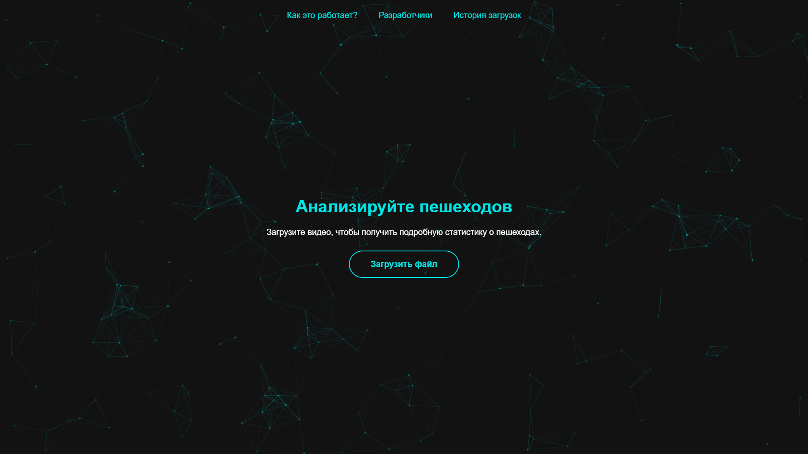
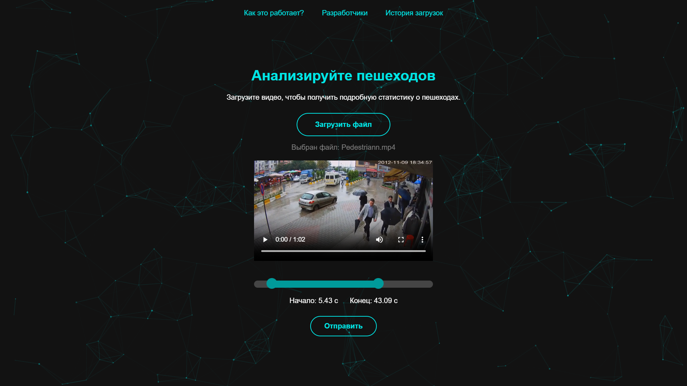
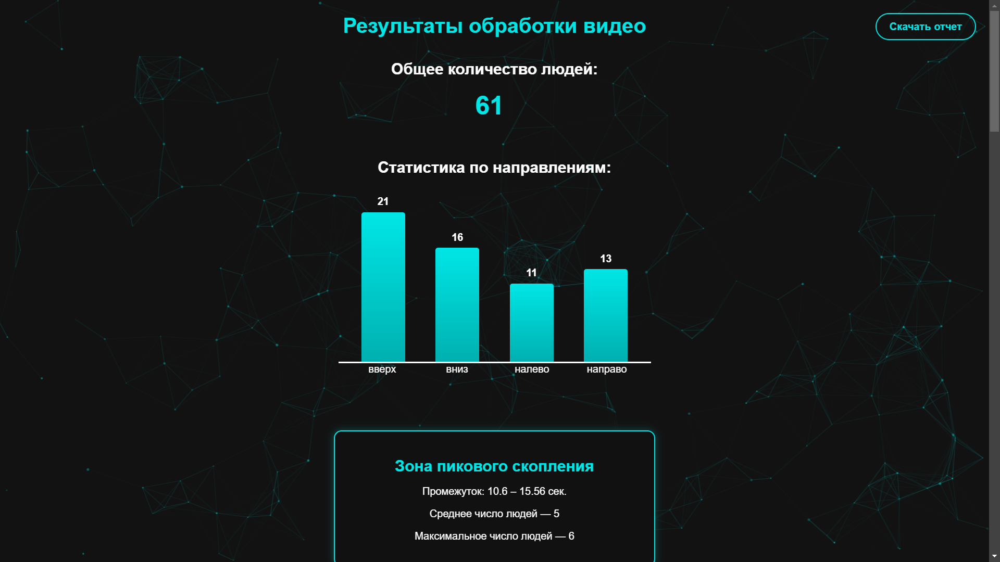
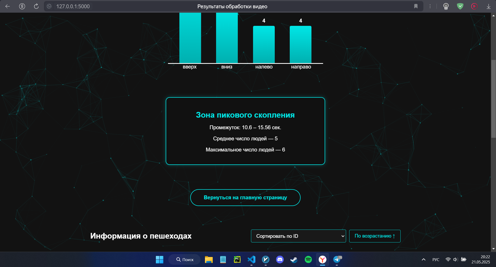
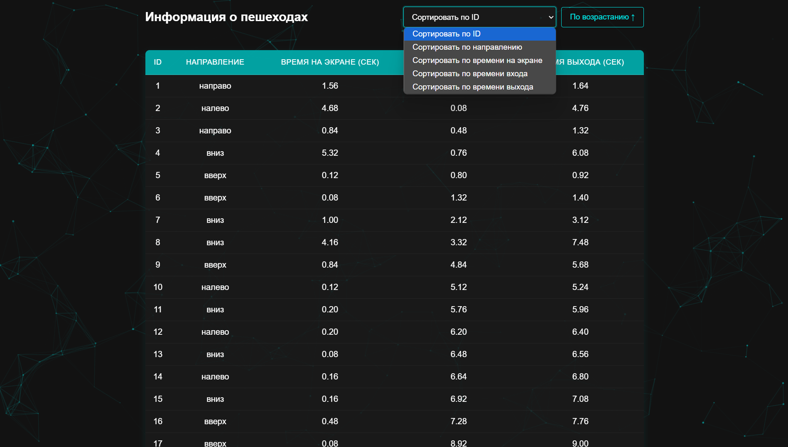
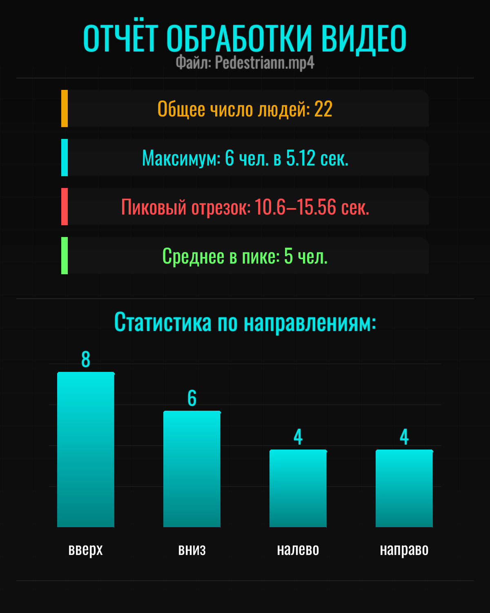
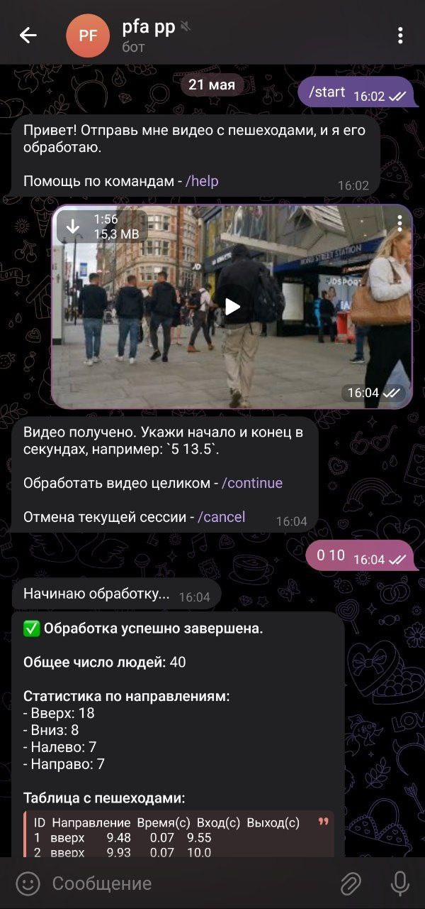
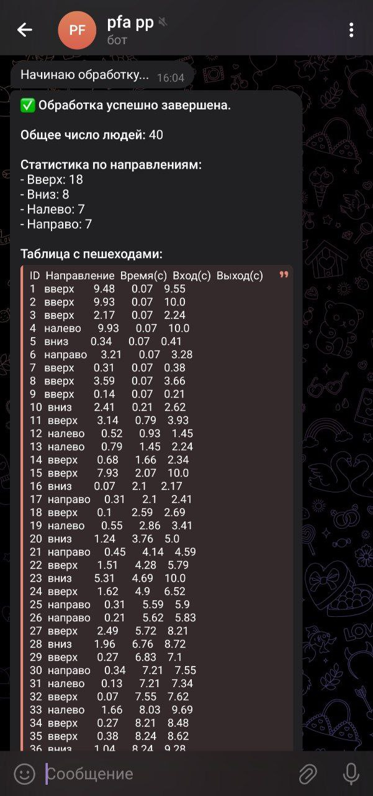

# 🚶 Pedestrian Analysis

A computer vision application that detects, tracks and analyzes pedestrian flow in video. It combines **YOLOv8** object detection with **DeepSORT** multi-object tracking to count unique people, determine their movement directions, measure how long each person stays in the frame, and find peak-density intervals. Results are presented in a web dashboard, as a downloadable visual report, and through a Telegram bot.

<p align="center">
  
  
</p>

---

## Table of Contents

- [Features](#features)
- [How It Works](#how-it-works)
- [Tech Stack](#tech-stack)
- [Getting Started](#getting-started)
- [Telegram Bot](#telegram-bot)
- [Output](#output)
- [Screenshots](#screenshots)
- [Project Structure](#project-structure)
- [Limitations](#limitations)

---

## Features

- **Video upload with time range selection** — analyze the whole video or only a selected interval.
- **Unique pedestrian counting** — each person keeps a stable ID across frames thanks to tracking.
- **Movement direction analysis** — every person is classified as moving up, down, left or right.
- **Dwell time** — how long each person stays in the frame.
- **Peak density detection** — the 5-second window with the highest average number of people.
- **Interactive results** — charts, statistics and a sortable table of all detected pedestrians.
- **Visual report** — a stylized PNG summary that can be downloaded in one click.
- **Telegram bot** — send a video in chat and receive a summary of the analysis.

---

## How It Works

```
Video ─► Frame sampling (selected range)
           │
           ▼
   YOLOv8n detection (class "person", conf ≥ 0.6)
           │
           ▼
   DeepSORT tracking ─► stable IDs across frames
           │
           ├─► Direction: dominant axis of centroid displacement
           ├─► Dwell time: first and last frame each ID appears in
           └─► Density: sliding 5-second window over people count
           │
           ▼
   results.json ─► Web dashboard (Chart.js) / PNG report (Pillow) / Telegram bot
```

---

## Tech Stack

| Layer | Technologies |
|---|---|
| **Computer vision** | Ultralytics YOLOv8, DeepSORT (`deep-sort-realtime`), OpenCV, NumPy |
| **Backend** | Python, Flask |
| **Frontend** | HTML, CSS, JavaScript, Chart.js, noUiSlider, html2canvas |
| **Reporting** | Pillow |
| **Bot** | python-telegram-bot |

---

## Getting Started

### Prerequisites

- Python 3.10+
- Git

### Installation

```bash
git clone https://github.com/nleaxy/PedestrianAnalysis.git
cd PedestrianAnalysis

python -m venv venv
# Windows
venv\Scripts\activate
# macOS / Linux
source venv/bin/activate

pip install -r requirements.txt
```

The pretrained `yolov8n.pt` weights are included in the repository, so no separate model download is required.

### Run the web application

```bash
python app.py
```

Open **http://localhost:5000**, upload a video, choose the time range and press **«Отправить»** (*Submit*). Processing time depends on the video length and your hardware.

> The interface is currently in Russian.

---

## Telegram Bot

1. Create a bot with [@BotFather](https://t.me/BotFather) and copy its token.
2. Install the bot library:
   ```bash
   pip install python-telegram-bot
   ```
3. Set the token in the `BOT_TOKEN` variable in `bot.py`.
4. Start the bot:
   ```bash
   python bot.py
   ```
5. Send a video to the bot, then enter a time range or send `/continue` to process the whole video. The bot replies with a summary of the analysis.

---

## Output

| File | Description |
|---|---|
| `output.mp4` | Processed video with bounding boxes, IDs, directions and dwell time |
| `results/results.json` | Structured analysis: unique count, direction statistics, peak moment, per-person timings |
| `results/report.png` | Visual summary with key metrics and charts |

---

## Screenshots

<p align="center">
  
  
  
</p>
<p align="center"><i>Results dashboard: total count, movement statistics, peak density interval and a sortable pedestrian table.</i></p>

<p align="center">
  
</p>
<p align="center"><i>Auto-generated report, available via the «Скачать отчет» (<i>Download report</i>) button.</i></p>

<p align="center">
  
  
</p>
<p align="center"><i>Telegram bot workflow.</i></p>

---

## Project Structure

```
PedestrianAnalysis/
├── app.py               # Flask web server
├── main.py              # Video processing: YOLOv8 detection + DeepSORT tracking
├── generate_report.py   # PNG report generation
├── bot.py               # Telegram bot
├── yolov8n.pt           # Pretrained YOLOv8 nano weights
├── templates/           # HTML pages
├── static/              # CSS, JavaScript, generated report
├── uploads/             # Uploaded videos
├── results/             # results.json and report.png
├── screenshots/
└── requirements.txt
```

---

## Limitations

- Direction is determined once per person, from their first significant movement, and is limited to four directions.
- Processing runs on a single request; very long videos may take a while and block the server.
- Accuracy depends on camera angle and crowd density; heavily occluded scenes can cause ID switches.
